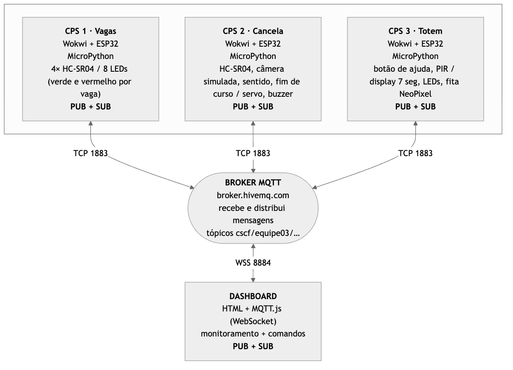
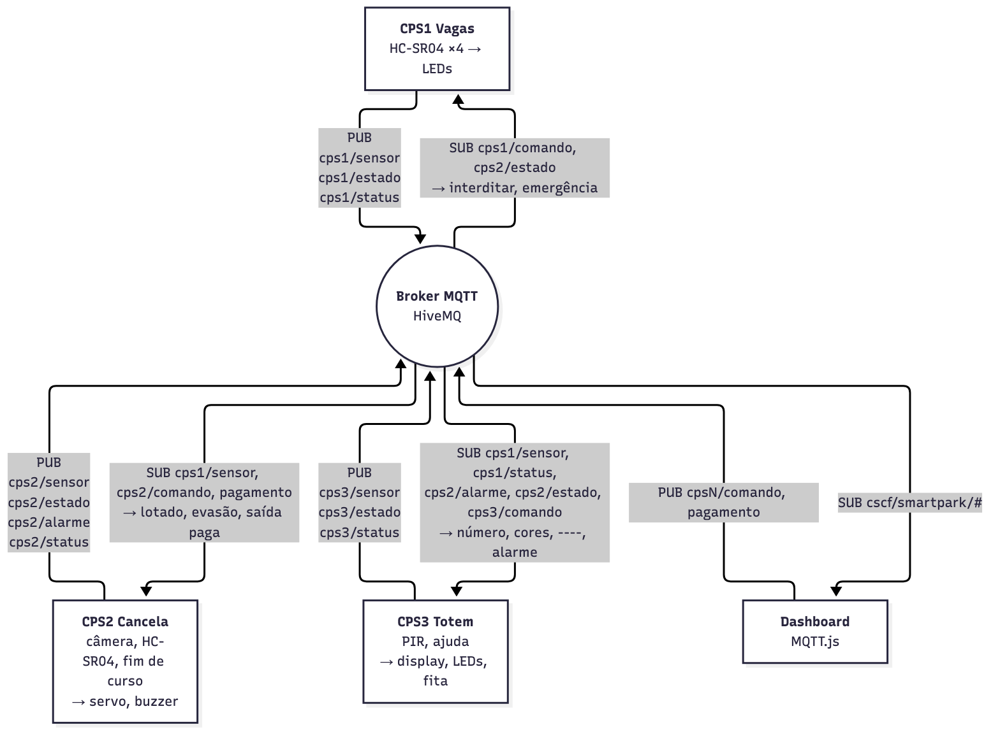

# SmartPark 2.0 · PUCPR

Estacionamento sem parar na cancela: cada vaga é medida, a câmera lê a placa e a cancela avisa quando falha. Três sistemas ciberfísicos (ESP32 + MicroPython no Wokwi) que só conversam por MQTT, mais um dashboard web.

Projeto final de Conectividade em Sistemas Ciberfísicos (PUCPR, 2026.2). Evolução do SmartPark de Fundamentos de Sistemas Ciberfísicos (2026.1), que está em [`Old/`](Old/); o que foi reaproveitado está em [`docs/reuso.md`](docs/reuso.md).

- Equipe: Enzo Bossmann [+ nomes, se houver equipe]
- Identificador nos tópicos: `smartpark` (constante `PREFIXO` em cada `main.py`)
- Entrega: 09/11/2026, 10:00

## Os três sistemas

| Sistema | Sensores | Atuadores | Publica | Assina |
|---|---|---|---|---|
| [CPS1 Vagas](cps1-vagas/) | 4× HC-SR04 (V1, V2 comuns, V3 idoso, V4 PcD) | LED verde/vermelho por vaga | vagas livres por tipo | comandos, emergência do CPS2 |
| [CPS2 Cancela](cps2-cancela/) | HC-SR04 (carro na cancela), câmera simulada (botões), chave de sentido, fim de curso | servo (cancela), buzzer | entradas, saídas, negações, alarmes, estado | vagas do CPS1, comandos, pagamento |
| [CPS3 Totem](cps3-totem/) | botão de ajuda, PIR | display 7 segmentos, LEDs, fita NeoPixel (1 LED por vaga) | ajuda, presença, estado | vagas e status do CPS1, alarmes e modo do CPS2, comandos |
| [Dashboard](dashboard/) | – | – | comandos, câmera, pagamento | tudo (`cscf/smartpark/#`) |

Integrações: lotado → a cancela nega; vagas ocupadas × entradas → alarme de evasão; cancela travada → o totem pisca; pagamento pelo celular → a saída abre; emergência → tudo abre e pisca; CPS1 cai → o totem mostra `----`. Detalhes em [`docs/topicos.md`](docs/topicos.md).

## Pastas

| Pasta | Conteúdo |
|---|---|
| `cps1-vagas/`, `cps2-cancela/`, `cps3-totem/` | `main.py`, `diagram.json` e link do Wokwi de cada sistema |
| `dashboard/` | dashboard HTML + MQTT.js (operador, gêmeo 3D, câmera simulada, pagar pelo celular) |
| `docs/` | arquitetura, tópicos, broker, funcionamento, reuso, pesquisa, guia de apresentação |
| `docs/apresentacao/` | apresentação animada (motion graphics) e folhas do apresentador |
| `video/` | roteiro da gravação e script de montagem do vídeo |
| `scripts/` | `verify` (prova por MQTT), CPS falsos, limpeza de retidos |
| `sim/` | hardware falso para rodar os `main.py` no MicroPython do computador e o teste de integração |
| `Old/` | SmartPark 2026.1, sem alteração |
| `SPEC.md` | escopo, regras, checagem de pronto e cortes |

## Como montar no Wokwi

1. Em wokwi.com, crie um projeto **ESP32 + MicroPython** para cada sistema.
2. Substitua o `diagram.json` pelo da pasta do sistema e cole o `main.py`. No CPS3, adicione também o arquivo `tm1637.py`.
3. Rode os três ao mesmo tempo, **cada um numa janela visível** (aba escondida pausa a simulação).
4. Sirva o dashboard (`python3 -m http.server 8000 -d dashboard`) e abra http://localhost:8000/ (por `file://` o navegador bloqueia os módulos).
5. Confira: `scripts/verify` deve terminar com `verify: passou`.

## Prova de funcionamento

- `scripts/verify`: assina o prefixo no broker e só passa (exit 0) se os 3 CPS estão `online`, o CPS1 publica 4 vagas e cada CPS responde a um `ping` no seu tópico de comando. Precisa de [`uv`](https://docs.astral.sh/uv/).
- `uv run sim/teste_integracao.py`: roda os três `main.py` reais no MicroPython do computador, com hardware falso, contra a HiveMQ, e confere as 8 integrações, a queda pelo Last Will e a reconexão. Última execução (06/11/2026): 0 falhas em 48 s. Precisa de `brew install micropython` e `micropython -m mip install umqtt.simple`.
- Antes de gravar o vídeo: `uv run scripts/limpar_retidos.py --prefix cscf/smartpark`.

## Broker

HiveMQ público (`broker.hivemq.com`): ESP32 em TCP 1883, dashboard em WebSocket seguro 8884. Last Will, retain e QoS 1 explicados em [`docs/broker.md`](docs/broker.md).

## Privacidade

Placas fictícias. No broker público qualquer um pode ler as mensagens; em produção a placa é dado pessoal (LGPD) e iria pseudonimizada, num broker com usuário e TLS.
