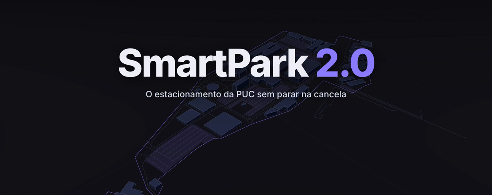
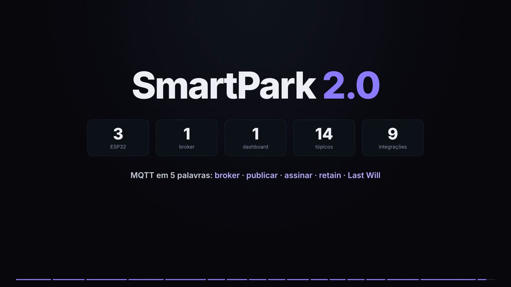
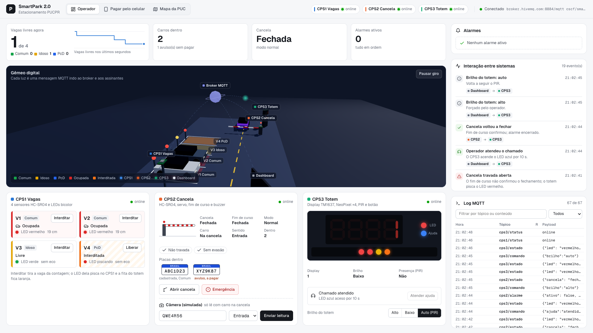

  

  
  
  
  
  

  <b>Três sistemas ciberfísicos que só conversam por MQTT, mais um dashboard web.</b> 
  Cada vaga é medida, a câmera lê a placa e a cancela avisa quando falha.

---

Projeto final de **Conectividade em Sistemas Ciberfísicos** (PUCPR, 2026.2). Evolução do SmartPark de Fundamentos de Sistemas Ciberfísicos (2026.1), que está em [`Old/`](Old/); o que foi reaproveitado está em [`docs/reuso.md`](docs/reuso.md).

| | |
|---|---|
| **Equipe 3** | Enzo Bossmann, Diego Feltrin e Gabriel Henrique |
| **Prefixo MQTT** | `cscf/equipe03` (constante `PREFIXO` em cada `main.py`) |
| **Entrega** | 09/11/2026, 10:00 |

## Vídeos

<table>
  <tr>
    <td align="center" width="50%">
       
      <b>Demonstração</b> (7 min) os 3 Wokwi, o broker e o dashboard rodando
    </td>
    <td align="center" width="50%">
       
      <b>Apresentação animada</b> (5 min) arquitetura, as 9 integrações e o item 9
    </td>
  </tr>
</table>

## Simulações no Wokwi

| Sistema | O que faz | Abrir |
|---|---|---|
| **CPS1 Vagas** | mede as 4 vagas e acende o LED de cada uma |  |
| **CPS2 Cancela** | lê a placa, abre ou nega e dá os alarmes |  |
| **CPS3 Totem** | mostra as vagas livres e atende o pedido de ajuda |  |

## Dashboard

## Os três sistemas

| Sistema | Sensores | Atuadores | Publica | Assina |
|---|---|---|---|---|
| [CPS1 Vagas](cps1-vagas/) | 4× HC-SR04 (V1, V2 comuns, V3 idoso, V4 PcD) | LED verde/vermelho por vaga | vagas livres por tipo | comandos, emergência do CPS2 |
| [CPS2 Cancela](cps2-cancela/) | HC-SR04 (carro na cancela), câmera simulada (botões), chave de sentido, fim de curso | servo (cancela), buzzer | entradas, saídas, negações, alarmes, estado | vagas e status do CPS1, ajuda do CPS3, comandos, pagamento |
| [CPS3 Totem](cps3-totem/) | botão de ajuda, PIR | display 7 segmentos, LEDs, fita NeoPixel (1 LED por vaga) | ajuda, presença, estado | vagas e status do CPS1, alarmes e modo do CPS2, comandos |
| [Dashboard](dashboard/) | – | – | comandos, câmera, pagamento | tudo (`cscf/equipe03/#`) |

## As 9 integrações

| # | Quando | O que acontece |
|---|---|---|
| 1 | as vagas mudam | o totem atualiza o número, a fita e o LED |
| 2 | lotou | a cancela nega a entrada |
| 3 | há mais vagas ocupadas do que entradas | alarme de evasão |
| 4 | a cancela trava aberta | o totem pisca |
| 5 | o motorista paga pelo celular | a saída abre |
| 6 | emergência | tudo abre e pisca |
| 7 | alguém aperta ajuda no totem | a cancela dá um bip para o operador |
| 8 | o CPS1 cai (Last Will) | o totem mostra `----` e a cancela para de negar por lotado |
| 9 | vaga PcD ocupada sem carro PcD dentro | o totem pisca a vaga e o dashboard avisa |

Detalhes em [`docs/topicos.md`](docs/topicos.md).

## Arquitetura

## Pastas

| Pasta | Conteúdo |
|---|---|
| `cps1-vagas/`, `cps2-cancela/`, `cps3-totem/` | `main.py`, `diagram.json` e link do Wokwi de cada sistema |
| `dashboard/` | dashboard HTML + MQTT.js (operador, gêmeo 3D, câmera simulada, pagar pelo celular) |
| `docs/` | arquitetura, tópicos, broker, funcionamento, reuso, pesquisa, guia de apresentação |
| `docs/apresentacao/` | apresentação animada (motion graphics) e folhas do apresentador |
| `video/` | roteiro da gravação e script de montagem do vídeo |
| `scripts/` | `verify` (prova por MQTT), CPS falsos, limpeza de retidos |
| `sim/` | hardware falso para rodar os `main.py` no MicroPython do computador e o teste de integração |
| `Old/` | SmartPark 2026.1, sem alteração |
| `SPEC.md` | escopo, regras, checagem de pronto e cortes |

## Como montar no Wokwi

1. Em wokwi.com, crie um projeto **ESP32 + MicroPython** para cada sistema.
2. Substitua o `diagram.json` pelo da pasta do sistema e cole o `main.py`. No CPS3, adicione também o arquivo `tm1637.py`.
3. Rode os três ao mesmo tempo, **cada um numa janela visível** (aba escondida pausa a simulação).
4. Sirva o dashboard (`python3 -m http.server 8000 -d dashboard`) e abra http://localhost:8000/ (por `file://` o navegador bloqueia os módulos).
5. Confira: `scripts/verify` deve terminar com `verify: passou`.

## Prova de funcionamento

- `scripts/verify`: assina o prefixo no broker e só passa (exit 0) se os 3 CPS estão `online`, o CPS1 publica 4 vagas e cada CPS responde a um `ping` no seu tópico de comando. Precisa de [`uv`](https://docs.astral.sh/uv/).
- `uv run sim/teste_integracao.py`: roda os três `main.py` reais no MicroPython do computador, com hardware falso, contra a HiveMQ, e confere as 9 integrações, a queda pelo Last Will e a reconexão. Última execução (08/11/2026, com o código final): 64 verificações, 0 falhas em 73 s. O `scripts/verify` também passou contra os três Wokwi de verdade (07/11/2026). Precisa de `brew install micropython` e `micropython -m mip install umqtt.simple`.
- Antes de gravar o vídeo: `uv run scripts/limpar_retidos.py --prefix cscf/equipe03`.

## Broker

HiveMQ público (`broker.hivemq.com`): ESP32 em TCP 1883, dashboard em WebSocket seguro 8884. Last Will, retain e QoS 1 explicados em [`docs/broker.md`](docs/broker.md).

## Privacidade

Placas fictícias. No broker público qualquer um pode ler as mensagens; em produção a placa é dado pessoal (LGPD) e iria pseudonimizada, num broker com usuário e TLS.
