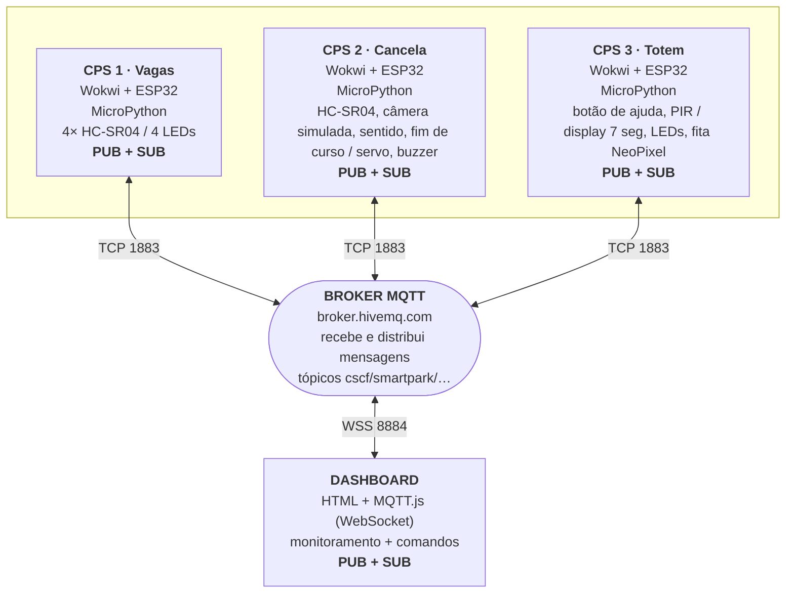

# Arquitetura de conectividade

Segue o modelo do enunciado: três CPS no topo, todos publicando e assinando no broker, e o dashboard abaixo. Nenhum sistema fala direto com outro; toda mensagem passa pelo broker.

Imagem para a entrega: `docs/arquitetura.png` (gerada deste diagrama com `mmdc`).

## Fluxos de integração (todos passando pelo broker)

| De | Tópico | Para | Efeito |
|---|---|---|---|
| CPS1 | `cps1/sensor` | CPS2 | lotado por tipo → cancela nega; vagas × `dentro` → evasão |
| CPS1 | `cps1/sensor`, `cps1/status` | CPS3 | display, LED e fita; `----` se o CPS1 cai |
| CPS2 | `cps2/alarme` | CPS3, dashboard | cancela travada ou evasão → LED piscando e alarme |
| CPS2 | `cps2/estado` | CPS1 | emergência → LEDs das vagas piscam |
| CPS3 | `cps3/sensor` | dashboard | pedido de ajuda |
| Dashboard | `cpsN/comando`, `pagamento` | CPS1, CPS2, CPS3 | interditar vaga, câmera, abrir cancela, emergência, pagamento, atender ajuda |

Tabela completa de tópicos: `docs/topicos.md`.

Ciclo CPS (item 6): aquisição (sensores) → processamento (ESP32 decide) → conectividade (MQTT pelo broker) → atuação (cancela, LEDs, display, fita) → realimentação (estado publicado com retain para os outros e o dashboard).
